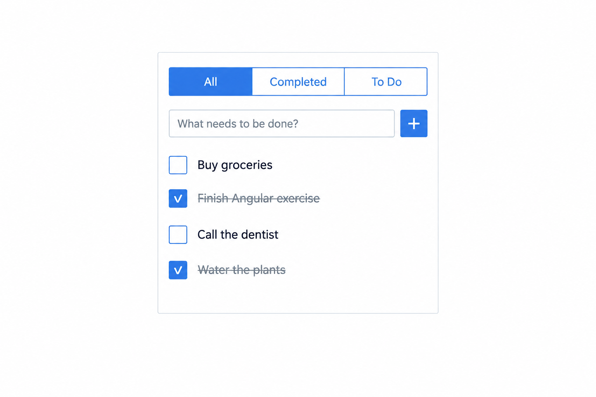
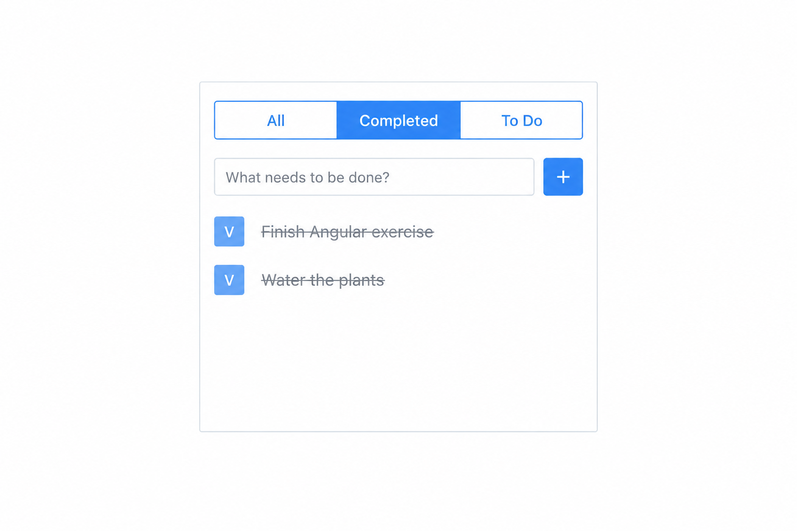
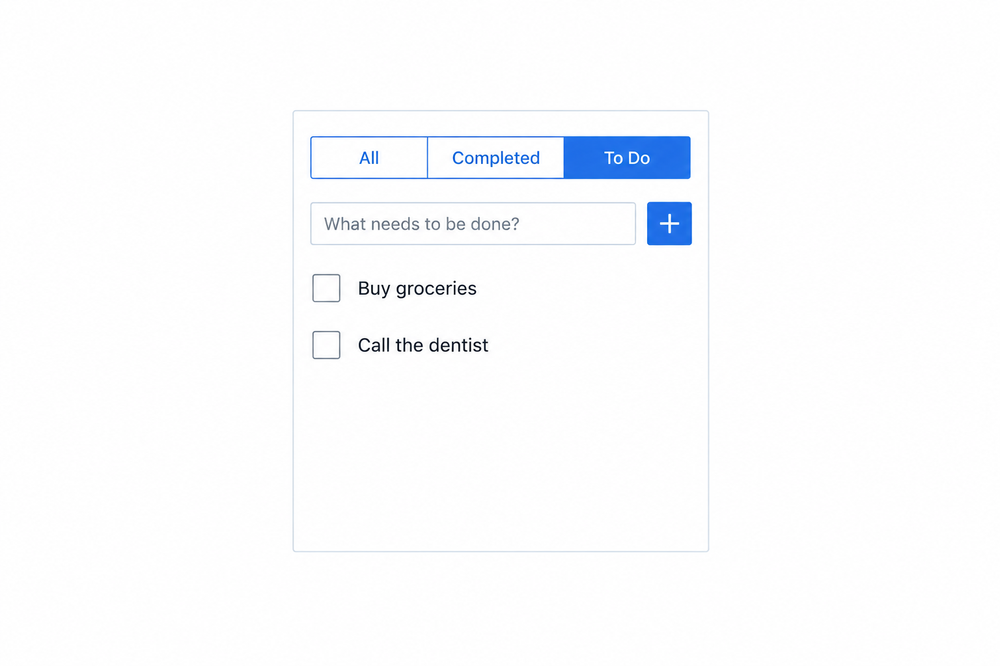

# Exercise: Todo List

Build a Todo List application with Angular.

## The screen

At the top of the screen, show a toolbar with three rectangular options:

- **All**
- **Completed**
- **To Do**

Only one option can be selected at a time. The selected option should look
different from the other options.

Below the toolbar, show:

- A text input where the user can type a todo reminder.
- A **+** button next to the input.

When the user clicks the **+** button, add the new todo to the list below the
input.

## Todo items

Show the todo items in a vertical list.

Each todo has two possible states:

- Completed
- Not completed

Place a square to the left of each todo caption:

- For a todo that is not completed, the square is empty.
- For a completed todo, the square contains a **V**.
- Clicking the square changes the todo between completed and not completed.

The square must be a `div`, not a button or checkbox. Style it so that users
can see that it is clickable. For example, it should have a pointer cursor and
a hover style.

When a todo is completed:

- Show its caption with a strikethrough.
- Change its caption color to gray.

## Filtering

The selected toolbar option controls which todos are visible:

- **All** shows every todo.
- **Completed** shows only completed todos.
- **To Do** shows only todos that are not completed.

## General guidelines

1. Use signals for application state.
2. Use immutable types.
3. Use computed signals when possible.

## Example screens

### All todos

### Completed todos

### Todos that are not completed

