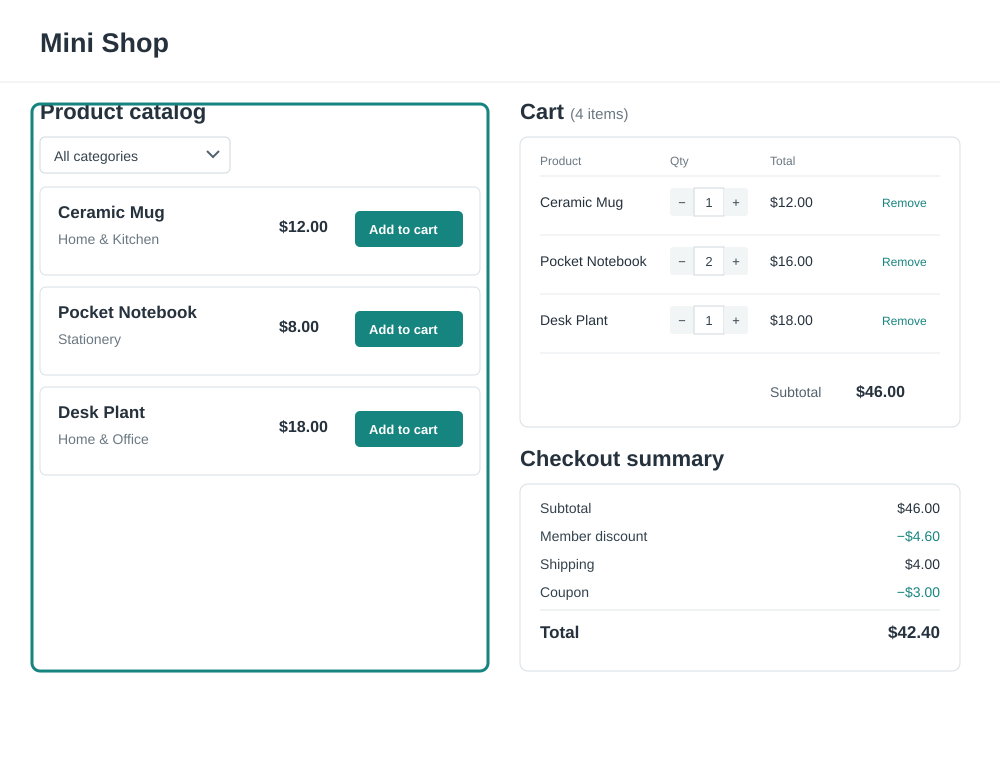
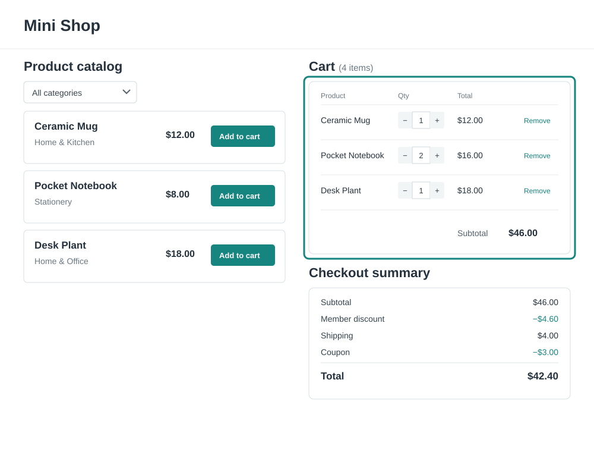
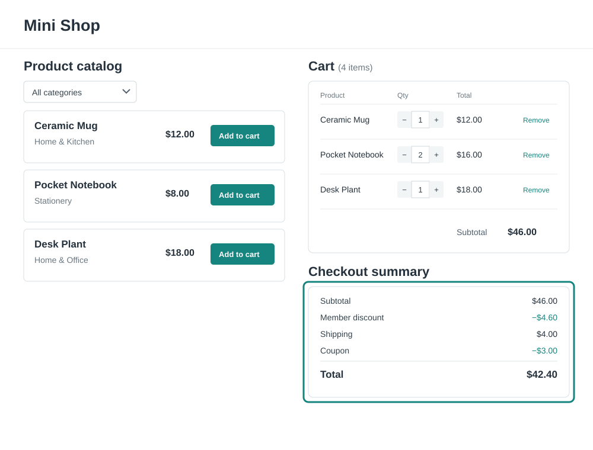

# Exercise: Mini Shop

Build a small shop on one page. Users can see products, add them to a cart, change item amounts, and see the final price.

The shop will also have price rules, such as discounts and shipping costs. Add these rules with Dependency Injection (DI).

This exercise reviews signals, immutable updates, components, and DI. First build the shop. Then do each DI task. For every DI skill, do the guided task first. Then try the second task on your own.

## What to build

The shop page must have:

- A list of products and an **Add to cart** button for each.
- A cart with each item's name, price, amount, and line total.
- Buttons to change an item's amount and remove it.
- A checkout summary with the subtotal, price rules, and final price.
- A category list to filter the products.

Keep the page simple. Do not add routes or a navigation pane. Use two columns:

- Put the product list on the left.
- Put the cart at the top of the right column.
- Put the checkout summary below the cart.

On a narrow screen, show the product list, cart, and checkout summary in one column, in that order. Product cards should use text and CSS only. You do not need product images.

## Example page layout

Each picture shows the **same full page**. The green outline marks the part to look at. It does not show a different page. Product cards have no images.

### Product list

### Cart

### Checkout summary

## Before you start

Use the Angular CLI to create an app and run it. Keep the starter app's standalone setup. Remove the starter content. Do not add routing. Show the whole shop on the root page.

You can use these components:

| Component | What it does |
| --- | --- |
| `ShopPage` (root) | Puts the product list on the left, and the cart and summary on the right. |
| `ProductList` | Shows products and the category list. |
| `ProductCard` | Shows one product and lets the user add it to the cart. |
| `Cart` | Shows cart items and lets the user change amounts or remove items. |
| `CheckoutSummary` | Shows the subtotal, price rules, and final price. |

The root page puts these components together. You may use different component names or files if each part has a clear job.

## Build the shop

Before you add DI, build the page:

1. Make types for products and cart items. Each cart item needs a product and an amount.
2. Make a short list of products. Give each product a name, category, and price.
3. Show the products. Let the user add a product to the cart.
4. Show the cart. Add controls to change amounts and remove items.
5. Add a category list. Show only products in the chosen category.
6. Put the product list on the left. Put the cart and checkout summary on the right.

### Review skills from earlier modules

Use these skills in your shop:

- Use **signals** for the main data: products, cart items, and chosen category.
- Use **computed signals** for values based on that data: filtered products, item count, line totals, subtotal, discounts, fees, and final price. Do not save a value that you can work out from other data.
- Do not change arrays or objects in place. Make new arrays and objects when you add, remove, or change cart items.
- Split the page into components.
- Use `input` to pass data to child components. Use `output` to send actions back to the parent.
- Use `model` for a value that both parent and child can change, such as the chosen category.

## Dependency Injection tasks

For each skill, do the **Guided task** first. Then do the **Try it yourself** task without step-by-step help.

### 1. A service and `inject()`

**Guided task**

1. Make a `CartService`. Use the way to provide services that you learned in class.
2. Move the cart signal and the add, change, and remove methods into the service.
3. Keep the writable signal private. Give other code a read-only signal.
4. Use `inject()` to get the service in the component that needs it.
5. Use the service methods in the page. Check that the cart and checkout summary update when the cart changes.

**Try it yourself:** Make a `CatalogService` for the product list. Use `inject()` to get it in the component that shows the products.

### 2. A custom token and provider/injector functions

Use a custom token for price rules. Each rule needs a name and a function that works out a price change from the subtotal. A rule can add to or take away from the price.

**Guided task**

1. Make a type for a price rule.
2. Make an `InjectionToken` for a list of price rules.
3. In the token file, make a `providePricingRule(...)` function. Use `makeEnvironmentProviders` to return the provider.
4. In the same file, make an `injectPricingRules()` function. It should call `inject()` with the token.
5. Add one rule, such as a member discount, in `app.config.ts`.
6. Use `injectPricingRules()` in the checkout code. Show each rule and the final price.
7. Keep the token private in its file. Other files should use the two functions.

**Try it yourself:** Add a coupon rule with the provider function. Do not change the checkout code to add this one rule.

### 3. Multi-providers

**Guided task**

1. Change `providePricingRule(...)` to use `multi: true`. This lets the app add many rules to the same token.
2. Add at least three rules in `app.config.ts`. For example, add a discount, a shipping cost, and a coupon.
3. Inject the list of rules. Show all the rules that apply in the checkout summary.
4. Check that you can add a new rule without changing the checkout code.

**Try it yourself:** Add a rule that applies only when the subtotal is above a set amount. Keep the checkout display the same for every rule.

### 4. Provider types

Choose a provider type based on the value you want to get.

**Guided task**

1. Make an `InjectionToken` for shop settings, such as the currency or the free-shipping amount.
2. Use `useValue` to provide a settings object. Inject it where the checkout needs it.
3. Make a pricing service with a method to work out a price. Use `useClass` to provide it.
4. Make a second token for the same service. Use `useExisting` so both tokens give the same service instance. Check that they do.
5. Use `useFactory` to make a value, such as a shipping rule based on the settings. Inject this value and use it in the checkout.

**Try it yourself:** Change one provider to another provider type that fits. Explain what value the consumer gets and whether it is the same instance.

### 5. The injector tree and component providers

**Guided task**

1. Add two temporary `CartDemo` components to the root page.
2. Add `CartService` to each `CartDemo` component's `providers` list.
3. Put a child cart component inside each `CartDemo`. Both child carts should get the service from their parent.
4. Add an item to each cart. Check that each demo has its own cart, and that each child uses its parent's cart.
5. For a test, also provide `CartService` at the root. Check which service each child gets. The closest provider should be used.
6. Remove the temporary demos when you finish. The final shop still has one product list, one cart, and one checkout summary on the root page.

**Try it yourself:** Provide another service or token on a component. Check which child components can get it.

### 6. Injecting `Injector` and using `runInInjectionContext`

This task is extra practice. Usually, `inject()` is called while Angular creates a component or service. You cannot call it later in a click handler or after `await` unless you use `runInInjectionContext`.

**Guided task**

1. Use `inject()` to get Angular's `Injector` while the component is being created. Save it in a field.
2. Add a button for a delayed checkout action.
3. In the button handler, call `runInInjectionContext` with the saved injector.
4. Inside the callback, use `inject()` to get a price rule. Do this before any `await`.
5. After the callback returns, use the rule for the delayed checkout action. Check that the rule comes from the right injector.

**Try it yourself:** Use the same steps to get another value in a button handler. Check which injector provides it.

## Check your work

- [ ] Users can see products and add them to the cart.
- [ ] Users can change amounts and remove cart items.
- [ ] Cart changes make new arrays and objects.
- [ ] Signals hold the main data. Computed signals work out the totals and filters.
- [ ] Components use `input`, `output`, and `model` where needed.
- [ ] `CartService` holds the cart data.
- [ ] Price rules use a custom token and multi-providers.
- [ ] Provider and injector functions keep the token private.
- [ ] The app shows provider types and the injector tree.
- [ ] The optional task uses `Injector` and `runInInjectionContext`.
