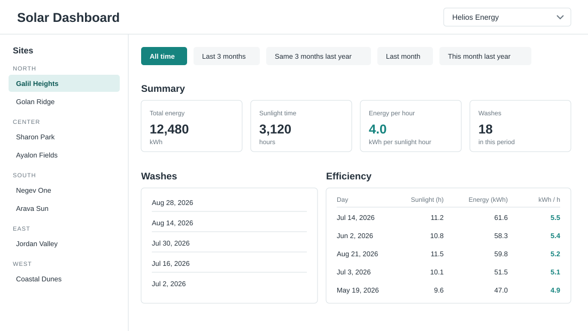
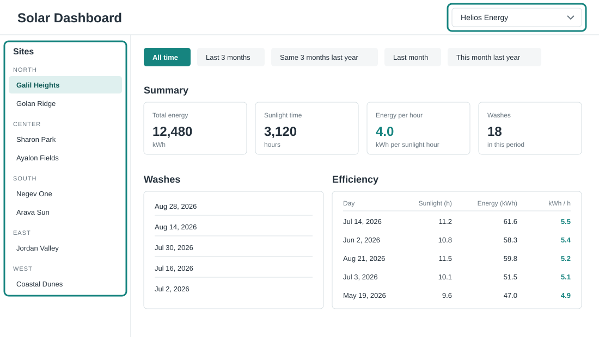
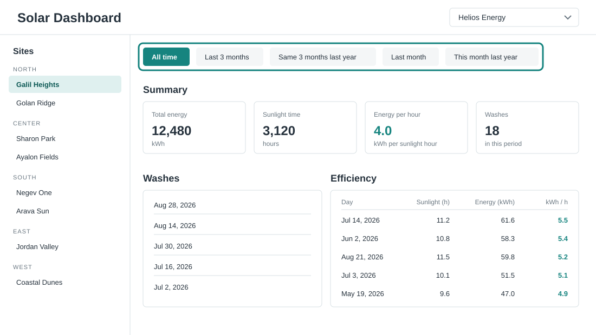
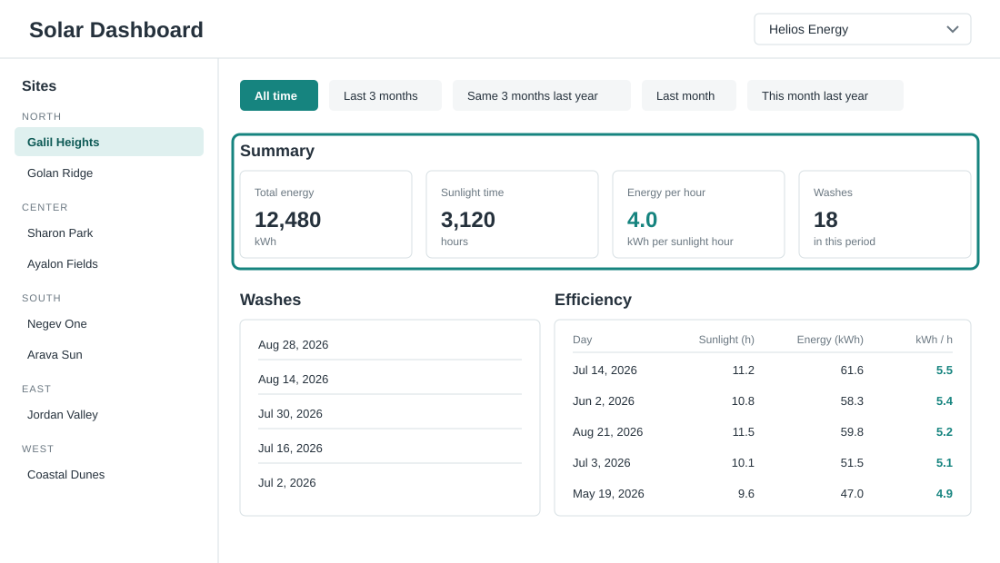
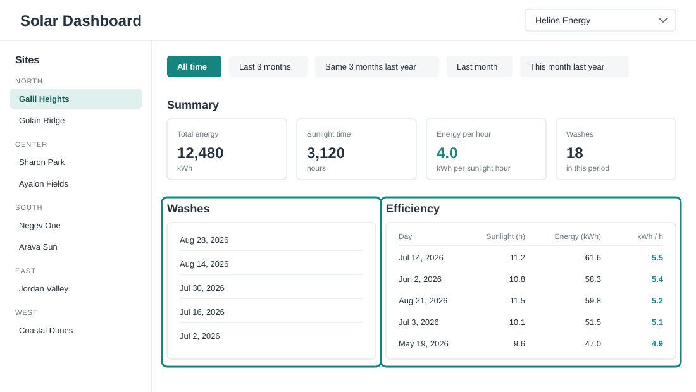

# Half-Way Project: Solar Dashboard

Build a data dashboard that tracks solar panel energy production. This project brings together everything you have learned so far: components, signals, immutable state, dependency injection (module 07), and HTTP (module 08).

You will build the app **in layers**, the same way the Mini Shop solution of module 07 is built:

1. **Code model** - plain types that describe the data.
2. **View models** - types that describe exactly what the screen shows.
3. **Builders** - pure functions that build view models from the code model.
4. **Services and state** - a data service for HTTP, and a state service that holds signals.
5. **Updaters** - pure functions that compute the next state.
6. **Components** - views (smart page parts), presenters inside the views, and reusable widgets.

Keep the Mini Shop solution open next to you. When a step says "like in the Mini Shop", go look at the pattern there. This README shows code only for things you have **not** seen before.

## A word about AI

AI tools are a great way to learn, and you are welcome to use them as a **consultant**: ask them to explain a concept, an error message, or a pattern, or to discuss which approach fits better. Talking a problem through with AI is a perfectly good way to get unstuck.

That said, try to keep the coding itself in your own hands:

- Prefer writing the code yourself over pasting generated code.
- If you accept a code suggestion, take a moment to make sure you understand every part of it.
- A good rule of thumb: you should be able to explain any line in your project.

This is the half-way project - its real value is showing yourself how much you can already build on your own. Code that AI wrote for you teaches you very little, so use it to understand more, not to type less.

## The story

Companies own solar panel **sites**. Every site is in one region: north, south, east, west, or center.

Every day, each site reports one **activity**: how much energy it produced (in kWh) and how many sunlight hours it had that day. Over time this becomes a large table of activities - one row per site per day.

Solar panels get dirty, so from time to time a site gets a **wash**. Each wash records the site and the day.

The dashboard lets a user:

- Pick a **company** in the header. The first company is selected automatically.
- Pick a **site** in the sidebar. The sidebar shows the sites of the selected company, grouped by region. The first site is selected automatically.
- Pick a **period** in a sub-header above the dashboard. There are five period ranges. "All time" is selected automatically.

For the selected site and period, the dashboard shows three sections:

| Section | What it shows |
| --- | --- |
| Summary | Total produced energy; total sunlight time; energy per sunlight hour (the first divided by the second); number of washes in the period |
| Washes | The last 5 washes in the period (or fewer, newest first) |
| Efficiency | The 5 days with the best efficiency (energy divided by sunlight hours). For each day: the sunlight time, the energy produced, and the efficiency number |

## Example page layout

Each picture shows the **same full page**. The green outline marks the part to look at. Keep the CSS this simple: use at most 5 black-white-gray shades, at most 3 shades of one primary color, and 1 error shade if you need it. Do not spend time on styling beyond basic borders, spacing, and colors.

### The full page



### Company picker and sites sidebar



### Period bar



### Summary section



### Washes and efficiency sections



## The server

The data comes from an API server that is included with the exercise, in the [server](./server) folder - the same kind of server you used in module 08. Start it from the exercise folder, in its own terminal, and keep it running:

```bash
npm run server
```

(or `node server/index.cjs`)

The server listens on `http://localhost:3000`. CORS is enabled, so the Angular app can call it directly. Responses have a small artificial delay, so you can see your loading states.

| Method | Path | Returns |
| --- | --- | --- |
| GET | `/companies` | All companies |
| GET | `/sites?companyId=<id>` | The sites of one company |
| GET | `/activities?siteId=<id>&period=<kind>` | The daily activities of one site, filtered by period |
| GET | `/washes?siteId=<id>&period=<kind>` | The washes of one site, filtered by period |

The shapes of the data:

```jsonc
// GET /companies
[
  { "id": "0b6e...", "name": "Helios Energy" },
  { "id": "9f2a...", "name": "SunGrid Ltd" }
]

// GET /sites?companyId=0b6e...
[
  { "id": "77c1...", "name": "Galil Heights", "region": "north", "companyId": "0b6e..." }
]

// GET /activities?siteId=77c1...&period=this-quarter
[
  { "id": "d410...", "siteId": "77c1...", "day": "2026-07-14", "energyKwh": 61.6, "sunlightHours": 11.2 }
]

// GET /washes?siteId=77c1...&period=this-quarter
[
  { "id": "5a9b...", "siteId": "77c1...", "day": "2026-08-28" }
]
```

Important notes:

- All ids are UUID strings.
- A `day` is an ISO string in the form `YYYY-MM-DD`. Two useful facts: these strings sort correctly as plain strings, and you can compare them with `<`, `<=`, `>`, `>=`. You never need to parse them.
- `/activities` and `/washes` accept an optional `period` query parameter. The server does the date filtering for you:

  | `period` value | Days returned |
  | --- | --- |
  | (omitted) | All days - "all time" |
  | `this-quarter` | The last 3 months, up to today |
  | `last-year-quarter` | The same 3 months, one year earlier |
  | `this-month` | The last month, up to today |
  | `last-year-month` | The same month, one year earlier |

- Because the server filters by period, changing the period on the dashboard sends **new HTTP requests** for activities and washes. You will see your loading state again - that is expected.

## Before you start

- Create a new app with the Angular CLI. Keep the starter app's standalone setup and remove the starter content.
- You may install `immer` if you want to use `produce` in your updaters, like the Mini Shop does.

Aim for this folder structure. It plays the same roles as the folders in the Mini Shop solution:

```
src/app/
  models/         the code model and the period logic
  view-models/    view model types + builder functions (pure)
  services/       data service, state service, updaters
  tokens/         custom DI tokens
  utils/          small pure helpers (sum, ...)
  views/          smart components (page parts), presenters nested inside
  components/     reusable widgets
```

Build the layers **in order**. Each layer only uses the layers before it. You can verify the lower layers work (with a quick `console.log`) before you write a single component.

## Step 1 - the code model (`models/`)

Create types for the server data: `Company`, `Site`, `Activity`, `Wash`, and a `Region` union type. Make all fields `readonly`, like `cart.model.ts` in the Mini Shop. Also add a constant with all regions in the order you want them to appear in the sidebar.

The five periods are also part of the model. Note the trick here: each period has a `kind` and a `label`. The `kind` values are **exactly** the values the server accepts in the `period` query parameter, and the `label` values are what the user sees on the buttons:

```ts
// models/period.model.ts
export type PeriodKind =
  | 'all-time'
  | 'this-quarter'
  | 'last-year-quarter'
  | 'this-month'
  | 'last-year-month';

export interface Period {
  readonly kind: PeriodKind;
  readonly label: string;
}

export const ALL_PERIODS: Period[] = [
  { kind: 'all-time', label: 'All time' },
  { kind: 'this-quarter', label: 'Last 3 months' },
  { kind: 'last-year-quarter', label: 'Same 3 months last year' },
  { kind: 'this-month', label: 'Last month' },
  { kind: 'last-year-month', label: 'This month last year' },
];
```

The server filters by period, so you do not need any date math on the client. The only date fact you will need: a `day` string in `YYYY-MM-DD` format sorts the same way the dates do, so you can sort and compare the strings directly.

## Step 2 - view models and builders (`view-models/`)

The rules, exactly as in the Mini Shop:

- A view model contains **exactly** what the template shows. No extra fields, no logic in the template.
- A builder is a **pure function**: code model in, view model out. No signals, no services, no `Date.now()` inside.

Create these view models and builders. The activities and washes arrive from the server already filtered by the selected period, so the builders do not deal with dates at all:

| File | View model | Builder |
| --- | --- | --- |
| `sidebar.vm.ts` | Region groups, each with its sites; each site has `id`, `name`, and `selected` | `buildSidebarVm(sites, selectedSiteId)` |
| `summary.vm.ts` | `totalEnergy`, `totalSunlightHours`, `energyPerHour`, `washCount` | `buildSummaryVm(activities, washes)` |
| `washes.vm.ts` | Up to 5 wash days, newest first | `buildWashesVm(washes)` |
| `efficiency.vm.ts` | Up to 5 rows: `day`, `sunlightHours`, `energyKwh`, `efficiency` | `buildEfficiencyVm(activities)` |

Hints:

- Reuse the `sum` utility idea from the Mini Shop's `math-utils.ts`.
- In the sidebar builder, go over the regions in your fixed order and skip regions that have no sites.
- Guard the divisions: when total sunlight is 0, `energyPerHour` should be 0, not `NaN`. Same for a day's efficiency - skip days with 0 sunlight hours.
- "Newest first" is just sorting the `day` strings - remember they compare correctly as plain strings.
- Never sort an array in place. Make a copy first (`[...items].sort(...)` or `items.toSorted(...)`).

## Step 3 - tokens and services

### 3a. The API base URL token (`tokens/`)

Do not hard-code `http://localhost:3000` inside the data service. Provide it with DI, exactly like the pricing-rule token in the Mini Shop:

1. Create a private `InjectionToken<string>` for the base URL.
2. In the same file, create `provideApiBaseUrl(url: string)` using `makeEnvironmentProviders`, and `injectApiBaseUrl()`.
3. Call `provideApiBaseUrl('http://localhost:3000')` in `app.config.ts`.

### 3b. The data service (`services/data.service.ts`)

Like the `DataService` from module 08: inject `HttpClient`, get the base URL with `injectApiBaseUrl()`, and write one typed method per endpoint:

- `getCompanies()`
- `getSites(companyId: string)`
- `getActivities(siteId: string, period: PeriodKind)`
- `getWashes(siteId: string, period: PeriodKind)`

When the period is `'all-time'`, do not send the `period` query parameter at all. Building a URL with query parameters is the same pattern as the color search in module 08.

### 3c. The dashboard state service (`services/dashboard.service.ts`)

This is the heart of the app, playing the role of `CartService` in the Mini Shop. It holds **one** private signal with the user's selection, loads data with resources, and exposes computed view models.

The selection state is small. The trick is that `null` means "not chosen yet - use the first one":

```ts
// models/dashboard.model.ts
export interface DashboardSelection {
  readonly companyId: string | null; // null = use the first company
  readonly siteId: string | null;    // null = use the first site
  readonly periodKind: PeriodKind;
}

export const INITIAL_SELECTION: DashboardSelection = {
  companyId: null,
  siteId: null,
  periodKind: 'all-time',
};
```

Build the service in this order, checking each piece with an `effect` + `console.log` before moving on:

1. A private `signal` holding the `DashboardSelection`, exposed as read-only.
2. A resource that loads the companies (use `rxResource` with the data service, like in module 08).
3. A computed `selectedCompanyId` that resolves `null` to the first company:

   ```ts
   readonly selectedCompanyId = computed(() =>
     this.#selection().companyId ?? this.companiesResource.value()?.[0]?.id ?? null);
   ```

4. A resource that loads the sites of the selected company. Use `selectedCompanyId` as the resource params. When the params value is `undefined`, the resource does not load - use that to wait until a company is known.
5. A computed `selectedSiteId` with the same fallback pattern, based on the sites resource.
6. Two more resources that load the activities and the washes of the selected site. This time the params must combine **two** values: the selected site id and the selected period kind. Make the params computed return one object with both, or `undefined` while there is no site yet. When either the site or the period changes, the resource reloads on its own - that is the whole point of resource params.
7. Computed view models that call your builders, one per section plus the sidebar. Resources may not have a value yet, so fall back to an empty array, for example `this.activitiesResource.value() ?? []`.
8. A computed `isLoading` so the views can show a loading message.
9. Public methods `selectCompany(id)`, `selectSite(id)`, and `selectPeriod(kind)` that `update` the selection signal using the updaters from step 4.

## Step 4 - updaters (`services/dashboard.updaters.ts`)

Like `cart.updaters.ts`: pure functions that take the current state and return the next state, immutably.

- `selectCompany(state, companyId)` - sets the company and resets `siteId` back to `null`. A new company means a new site list, and `null` makes the first site of that list selected automatically. This is why the pattern in step 3c works.
- `selectSite(state, siteId)`
- `selectPeriod(state, periodKind)`

## Step 5 - components

Divide the components into three groups, like the Mini Shop:

- **Views** (`views/`) - smart components. They inject `DashboardService`, read a view model signal, and call service methods on user events.
- **Presenters** - dumb components nested inside the view that uses them (like `product-item` inside `catalogue-view`). They only use `input` and `output`.
- **Widgets** (`components/`) - small reusable components with a general purpose (like `number-spinner`). They never inject services.

| Component | Kind | Job |
| --- | --- | --- |
| `App` (root) | view | The page layout: header, sidebar, main area |
| `CompanyHeader` | view | The title and the company `<select>`; first company selected |
| `SitesSidebar` | view | Region groups with their sites; clicking a site selects it |
| `SiteItem` | presenter | One site row; gets the site vm as `input`, emits a select `output` |
| `PeriodBar` | view | Five period buttons from `ALL_PERIODS`; the selected one is highlighted |
| `SummaryView` | view | Shows the summary vm using four `StatCard`s |
| `WashesView` | view | The last washes list |
| `EfficiencyView` | view | The top efficiency days table |
| `StatCard` | widget | Inputs: `label`, `value`, `unit`. Shows one number with its texts |

You may use different names or split differently, as long as each component has one clear job and the three groups stay separate.

Hints:

- For the company `<select>`, use the same pattern as the category `<select>` in `catalogue-view`: a template reference variable and a `(change)` handler that calls the service.
- Use `DatePipe` to format the day strings, and `DecimalPipe` (`number`) for the numbers - the same way the Mini Shop uses `CurrencyPipe`.
- Show a short "Loading..." text while the resources load.
- Round the efficiency numbers in the **builder**, not in the template, if you want full control - or format with a pipe. Pick one approach and be consistent.

## Check your work

- [ ] The server runs on port 3000 and the app loads companies from it.
- [ ] The first company is selected automatically; so is the first site of that company.
- [ ] Changing the company reloads the sites and auto-selects the first site of the new company.
- [ ] The sidebar groups sites by region and hides empty regions.
- [ ] "All time" starts selected. Changing the period sends new requests for activities and washes with the `period` query parameter (check the network tab) and updates all three sections.
- [ ] The summary shows total energy, total sunlight time, energy per sunlight hour, and the wash count for the period.
- [ ] The washes section shows at most 5 washes, newest first, only from the period.
- [ ] The efficiency section shows the 5 best days by energy per sunlight hour.
- [ ] All builders and updaters are pure functions.
- [ ] View models are built inside `computed` in the service; templates only display them.
- [ ] Presenters and widgets never inject services; they use `input` and `output` only.
- [ ] The API base URL comes from a custom token with provide/inject functions.
- [ ] The page shows a loading state while HTTP requests run.
- [ ] The CSS stays minimal: at most 5 neutral shades, 3 primary shades, 1 error shade.
